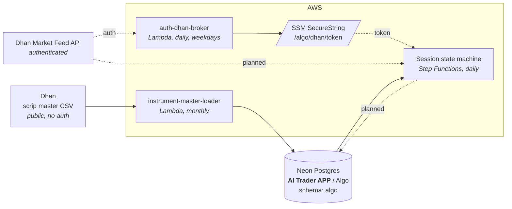

# Architecture

← [Back to root README](../README.md) · [Flow charts](flow.md) · [Components](components.md)

## System context

This repo is the **data layer** of an Indian-index algo trading system, rebuilt
on AWS Lambda. It does not place orders. Its job is to keep a correct,
replayable picture of the market in Postgres so that the decision layers above
it have something deterministic to read.

Two planes run on different clocks and are deliberately **not** coupled:

| Plane | Cadence | Trigger | Status |
|---|---|---|---|
| Instrument master refresh | monthly | EventBridge Scheduler cron | **built** |
| Broker token refresh | daily, weekdays 07:30 Mon → 08:30 Fri | EventBridge Scheduler cron, one per weekday | **built** |
| Daily candles + daily read | daily, weekdays 09:35 | EventBridge Scheduler cron | **built** |
| Intraday candles | every 15 min, 09:45–15:35 | EventBridge Scheduler cron — **the only intraday one** | **built** |
| Intraday market measurement | on each loader run, 25×/day | invoke from `intraday-data-loader` | **built** |
| Intraday classification | on each snapshot, 25×/day | invoke from `intraday-market-sentiment` | **built** |
| Turn detection | on each snapshot, 25×/day | invoke from `market-classifier` | **built** (log-only since 2026-11-09 16:04: no Telegram, no manager) |
| F&O reading, 5-min | every 5 min, 09:36–15:31, 71×/day | EventBridge Scheduler cron (its own trio) | **built** |
| Pattern recording + alerts (v2.1; rules v2.2 since 2026-11-19) | on each 5-min tick, as the poller's last step | invoke from `intraday-fno-poller` (unset = off) | **built** (v2.1 sending since 2026-11-09 16:04; v2.0 recorded from 2026-11-06 on the detector's hand-off) |
| Strategy routing | on each v2.1 alert, once — and on every 5-min tick (since 2026-11-14) | invoke from `pattern-recorder` (unset = off) | **built** (from `pattern-detector` on a confirmed turn until 2026-11-09). An alert routes on its `day_trend`: up/down → the trend playbook, `none` → nothing (the `regime\|bias` registry it went to from 2026-11-09 22:37 was removed with bias, 2026-11-19). Every tick → `TICK_PLAYBOOKS` (the sweep) |
| Trend pullback playbook | on an alert whose `day_trend` is up or down | invoke from `strategy-manager` (`TREND_PLAYBOOKS`) | **built** (sending since 2026-11-11 16:56; shadow from 2026-11-09 22:33) |
| Range sweep playbook | on every 5-min tick since 2026-11-14 (before that on a no-trend `sideways\|range-bound` alert); entries when price is within the levels (PDH/PDL, 15-min high/low) and the regime is not `volatile-expansion` — no bias, no trend test (since 2026-11-15 09:33); after entry, 3 lots: 2 booked at T1, the 15-min range midpoint, the last to T2 on a stop that never moves, plus the exit / one re-entry and the 15:15 close (since 2026-11-22) | invoke from `strategy-manager` (`TICK_PLAYBOOKS`) | **built, running** |

**No Step Functions state machine was built.** An earlier design had one
sequencing History → Regime → Strategy; what exists instead is a set of
independently scheduled Lambdas, each on its own clock. That keeps failure
domains separate — a bad token refresh raises its own alarm rather than failing
a session — and it removed the plane where secrets would have travelled as step
output.

**The strategy plane is chained rather than scheduled, and it is the one
exception.** `strategy-manager`'s input *is* the intraday snapshot, so
`intraday-market-sentiment` invokes it once the row is written, and it invokes
the strategies valid for the alert's `day_trend` (the regime|bias registry was removed with bias, 2026-11-19). A cron there would have to
guess how long the snapshot takes, read the row back out of Postgres, and decide
what to do when it is not there yet.

Failure domains still stay apart, because **every invoke in the chain is
`Event`**. An asynchronous invoke cannot fail its caller: the snapshot function
finishing is not a claim that any strategy succeeded, and each function has its
own log group with `error-notifier` reporting from it. What the chain buys over
a state machine is that no step's output — and so no token — ever sits in an
execution history.

## Why secrets live in SSM

`auth-dhan-broker` writes the token to an SSM `SecureString` rather than
handing it to consumers directly. The original reason was Step Functions: it
records the input and output of every state in its execution history, readable
through `GetExecutionHistory` and retained for around 90 days with no
field-level redaction — a token passed that way would sit in plaintext where a
token in SSM sits behind `ssm:GetParameter` plus `kms:Decrypt`.

The state machine was never built, but the pattern earned its place anyway and
now covers three parameters:

| Parameter | Written by | Read by |
|---|---|---|
| `/algo/dhan/token` | `auth-dhan-broker` | `daily-market-sentiment`, `intraday-data-loader`, `intraday-market-sentiment`, `intraday-fno-poller`, `pattern-recorder` |
| `/algo/telegram/brief` | by hand | `daily-market-sentiment`, `error-notifier`, `auth-dhan-broker`, `pattern-detector`, `pattern-recorder` |
| `/algo/neon/connection` | by hand | every function that touches Neon |

The last one replaced a `NEON_CONNECTION_STRING` environment variable
duplicated across functions. Environment variables are encrypted at rest but
readable by anyone holding `lambda:GetFunctionConfiguration`, and rotating the
database password meant editing every function that carried it. One parameter,
one edit.

Each function keeps an environment-variable override for local testing, and
logs which source it used — so a stale variable cannot quietly shadow a rotated
parameter.

## Why the loader sits outside the state machine

The instrument master is reference data, not session data. It changes when the
exchange lists or expires contracts — roughly monthly — while the state machine
runs per trading day. Coupling them would mean either re-fetching a 25 MB CSV
every morning or letting a slow, rarely-needed step sit on the critical path of
every session.

The monthly cadence is inherited from `should_load_instrument_master()` in the
legacy `trading-algo/data/database_service.py`, which reloads whenever no row
carries `updated_at >=` the first of the current month.

## Data store

**Neon project `AI Trader APP`** (`nameless-mountain-15353651`), database
`Algo`, schema `algo`. Neon is serverless Postgres — the compute autosuspends
when idle, which is a good fit for workloads that run monthly or once a day, at
the cost of a wake-up on the first connection of each run.

| Table | Shape | Rows | Written by |
|---|---|---|---|
| `instrument_master` | `security_id, trading_symbol, exchange_segment, instrument_type, lot_units, updated_at` | 15,463 | instrument-master-loader |
| `candle_daily` | `security_id, instrument_type, candle_ts, open, high, low, close, volume` | 408 | daily-market-sentiment |
| `daily_market_sentiment` | 31 columns — regime, structure, previous-day levels, the SMA/RSI inputs, VIX-implied expected move (bias and score dropped 2026-11-19) | 1 | daily-market-sentiment |
| `candle_5min` | same shape as `candle_daily` | 8,775 | intraday-data-loader |
| `candle_15min` | same | 2,925 | intraday-data-loader |
| `candle_1hr` | same | 819 | intraday-data-loader |
| `intraday_fno_data` | measurement — basis, futures OI, VIX, straddle/PCR/OI/max-pain/IV for two expiries as `near_*`/`mth_*` pairs, the SMA/RSI scalars, and NIFTY 50 / NIFTY 500 advance-decline breadth | 92 | intraday-market-sentiment |
| `intraday_sentiments` | judgement — regime, structure, buildup, day_trend, and the swing/volatility reads; joins `intraday_fno_data` on `snapshot_ts` | 92 | market-classifier |
| `option_chain_snapshot` | `… snapshot_ts, expiry_ts, strike, option_type` + the raw leg (ltp, OI, volume, IV, greeks, bid/ask) | 920 | intraday-market-sentiment |
| `index_constituents` | `index_name, security_id, instrument_type, exchange_segment, symbol, updated_at` — the NIFTY 50 / NIFTY 500 rosters for breadth, maintained by hand | 548 (NIFTY50 50, NIFTY500 498) | seeded by hand |
| `pattern_events` | v2 pattern events: one per (`rules_version`, trigger bar, family, subtype, direction) — level, candles, volume flags. **No OI, no outcome** (both joined at read time). [schema](../pattern-recorder/schema.sql) | created 2026-11-06; written from the 09:45 run that day (2 rows) | pattern-recorder |
| `playbook_alerts` | the **alert register**: one row per alert — a level a playbook watched, touched on one side, under one rule set (`current` / `new`) — with its retests (`touch_log`: per touch, why it did or did not give an entry), its `status` (watching / entered / blocked / missed / invalid / ended / covered) and, when entered or blocked by the gate, the trade and its steps. Candle times are 5-min candle starts. Rebuilt and upserted on every run; **nothing reads it back**. `derived_through_ts` (the newest candle of the run that wrote a row) stops a late, older tick from overwriting a newer register (since 2026-11-14 23:08). [schema](../strategy-range-liquidity-sweep/schema.sql) | created 2026-11-14, just before 22:01 IST; 9 rows (2026-11-13, from the deploy's smoke runs) | strategy-range-liquidity-sweep, when `REGISTER_ENABLED=on` (on since 2026-11-14 22:01) |
| `session_observations` | hand-logged ground truth: one row per pattern Amar flags — event candle, `pattern_type`, outcome, signal agreement, notes — and, since 2026-11-14, `alert_ts` / `entry_ts` (5-min candle starts, the same convention as `playbook_alerts`) and `entry_price` — Amar's own marks on 2026-11-16 → 11-19, the machine's values (the playbook's alert and entry) from 2026-11-20. [schema](../observations/schema.sql) · [runbook](session-observation-runbook.md) | 17 (2026-11-20) | by hand, on Amar's sign-off — never a function |

**The strategy plane has two writers.** `pattern-recorder` records what the v2
rules recognise to `pattern_events`; since 2026-11-14 `strategy-range-liquidity-sweep`
records its alert register to `playbook_alerts`. Neither ever writes the hand-logged
`session_observations`. Since v2.1 (live 2026-11-09 16:04) it also sends the alerts:
each event that passes the alert rule goes to Telegram and to strategy-manager, once
each. The `telegram_sent_at` / `manager_sent_at` marks on its rows record the sends.

**Otherwise the strategy plane added no tables.** `strategy-manager` is a pure router: it
opens no connection at all. `strategy-range-liquidity-sweep` runs on every 5-min
tick since 2026-11-14: it takes today's closed index candles from the tick payload
and reads `candle_daily` for ATR and today's 15-min rows (`intraday_fno_data` +
`intraday_sentiments`, each as in force at the candle it judges).
`strategy-trend-pullback` reads nothing: the payload `pattern-recorder` builds and
the manager passes through carries the alert, today's closed index candles and the
daily read. The manager and the trend playbook write nothing; the sweep writes
only its alert register, a record rebuilt whole on every run that nothing reads
back. The
regime the manager classifies travels in the invocation payload and each
strategy records it in its own log alongside what it found, so the decision is
recoverable from the consumer rather than duplicated by the producer. Nothing a
strategy decides on can therefore go stale in a table.

Two things they need are deliberately **not** stored and are recomputed instead
— daily `atr_14`, and the pivot levels, which `daily_market_sentiment`'s schema
comment calls "a pure function of pd_high/pd_low/pd_close". No schema change
was needed to build the strategy plane.

Row counts as of 2026-09-11; the two `intraday-market-sentiment` tables sit at
0 because the function has not yet run a live session - its schema is applied
and its schedules are live from 2026-09-14. `candle_daily` holds 204 NIFTY
and 204 INDIA VIX candles from the cold start. The intraday candle tables hold
NIFTY and NIFTY-SEP2026-FUT over a 90-day window — exactly 75 five-minute, 25
fifteen-minute and 7 hourly bars per session, with no misaligned rows.

The intraday **candle** tables hold **one partial bar each while the session is
open** — Dhan returns the in-progress bucket and the loader stores it,
correcting it by primary key on a later pass. A reader tells a closed bar from a
forming one with `candle_ts + interval_seconds <= now`; everything older than
the newest bar is final, so replay is unaffected.

The two **sentiment** tables are the deliberate opposite: a snapshot row is
never revisited, so `intraday-market-sentiment` reads only closed bars and
nothing it writes is ever partial. Its `snapshot_ts` is the closed bar itself
rather than the run clock, which also makes a repeated invocation idempotent.

**`security_id` alone is not an identity.** 19 security_ids carry more than one
`instrument_type` — `13` is both NIFTY (`IDX_I`/`INDEX`) and ABB
(`NSE_EQ`/`EQUITY`). A lookup missing the `instrument_type` silently resolved to
ABB on 2026-09-11 and wrote 204 ABB candles labelled NIFTY. Always query on the
pair.

## Invariants

These hold across the whole system and are the reason it is built this way.

1. **Every time value is epoch seconds.** `updated_at`, `candle_ts`, and every
   timestamp added later. No `timestamptz` columns, no timezone arithmetic in
   SQL. Display conversion to IST happens at the edge, never in storage.
2. **`exchange_segment` is the raw Dhan segment code** — `NSE_EQ`, `IDX_I`,
   `NSE_FNO`, `BSE_FNO` — never a human-readable string. Downstream code passes
   it straight back to the broker API.
3. **`(security_id, instrument_type)` identifies an instrument.** It is the
   primary key of `instrument_master` and the join key used by the candle
   tables. `security_id` is `text`, not an integer, deliberately.
4. **The trading system is fully deterministic and replayable.** Given the same
   stored data it reaches the same decisions. Any LLM in the loop reads from
   this store and never writes a decision into it.

## Deployment shape

Everything is a **zip-packaged Lambda with a pure-Python layer** — no container
images, no Docker build.

An earlier iteration moved to containerised ECS Fargate tasks on the grounds
that pandas, psycopg2 and the `dhanhq` SDK do not fit Lambda's packaging
limits. That was abandoned: the packages turned out to be avoidable rather than
mandatory. The scrip master is a public CSV parseable with stdlib `csv`, and
[pg8000](../layers/neon-db-driver/README.md) is a pure-Python Postgres driver.
Dropping those three dependencies removed the reason to leave Lambda.

The rule that keeps it that way: **prefer pure Python**. A C extension is not
forbidden, but it has to earn its place — what it buys, why no pure-Python
equivalent does the job, and the packaged size measured against Lambda's limits
before it goes in.
