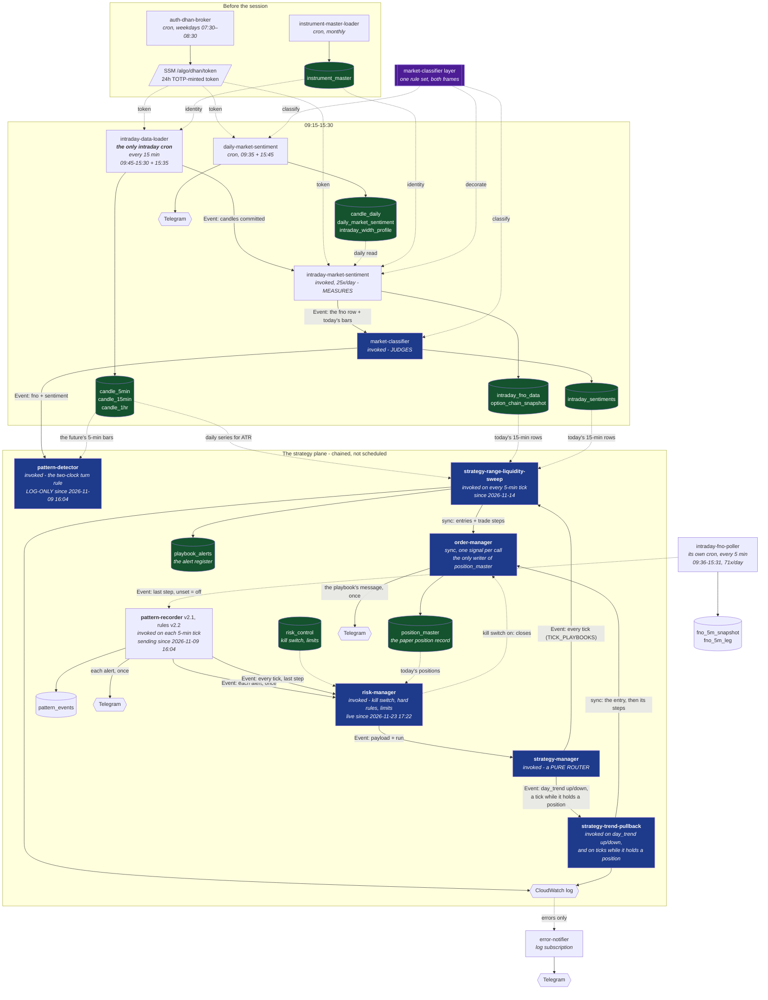
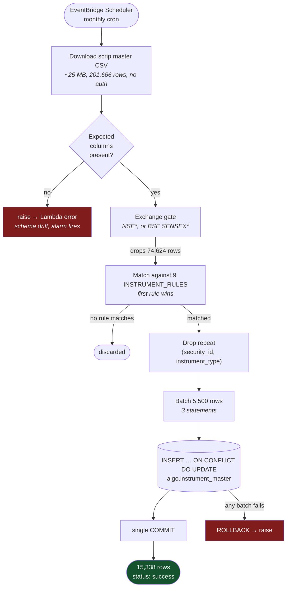
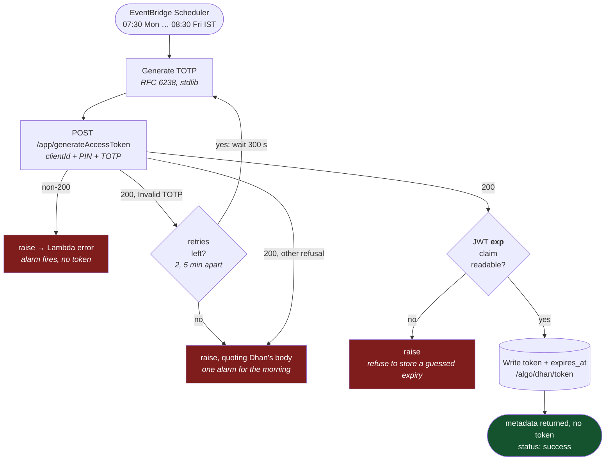
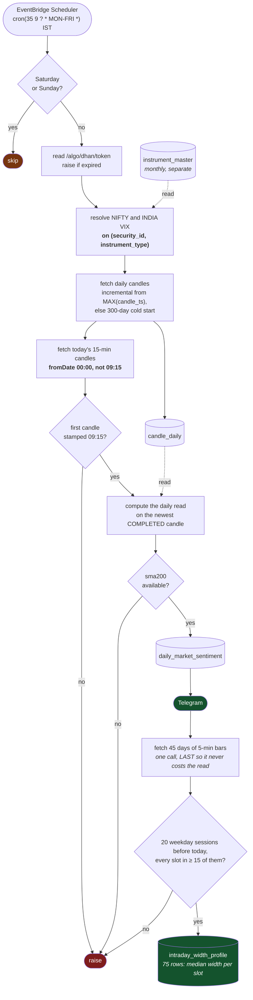
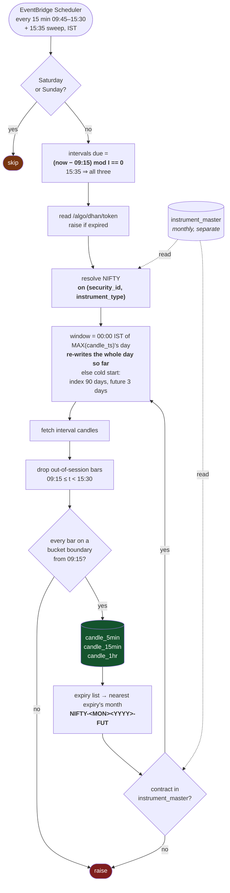
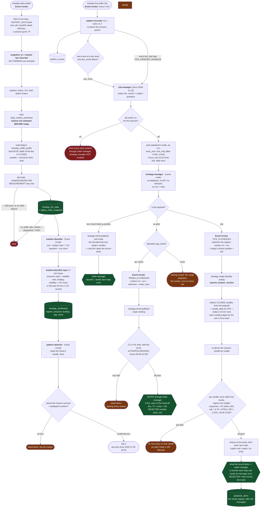
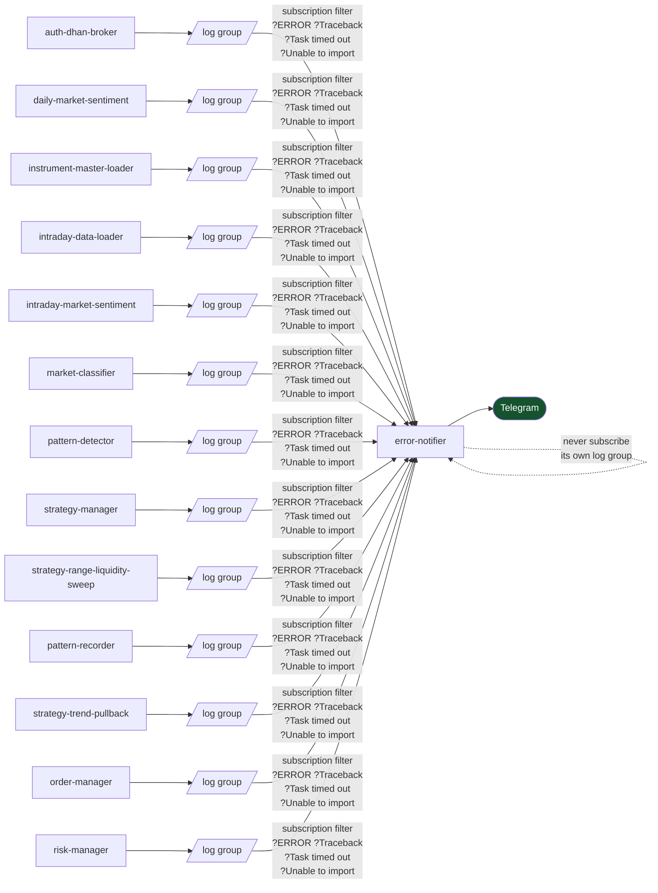

# Flow charts

← [Back to root README](../README.md) · [Architecture](architecture.md) · [Components](components.md)

## A trading day, end to end

Everything below this section is one plane in detail. This is the order they
actually happen in, and what hands off to what.

Read in clock order, a weekday looks like this:

| Time (IST) | What runs | Trigger | Writes |
|---|---|---|---|
| monthly | `instrument-master-loader` | cron | `instrument_master` |
| 07:30 Mon, 15 min later each day to 08:30 Fri | `auth-dhan-broker` | cron | `/algo/dhan/token` |
| 09:35 | `daily-market-sentiment` | cron | `candle_daily`, `daily_market_sentiment`, Telegram (the morning brief, since 2026-11-22), `intraday_width_profile` (today's normal 5-min width per slot, since 2026-11-12) |
| 09:45–15:30 every 15 min, + 15:35 | `intraday-data-loader` | **cron** | the three candle tables |
| immediately after each of those 25 runs | `intraday-market-sentiment` | **invoke** | `intraday_fno_data`, `option_chain_snapshot` |
| immediately after | `market-classifier` | **invoke** | `intraday_sentiments` |
| immediately after | `pattern-detector` | **invoke** | no table (log only since 2026-11-09 16:04) |
| 09:36–15:31 every 5 min (71 runs) | `intraday-fno-poller` | **cron** (its own trio) | `fno_5m_snapshot`, `fno_5m_leg` |
| as the poller's last step, every tick (v2.1, sending since 2026-11-09 16:04) | `pattern-recorder` | **invoke** | `pattern_events`, Telegram; then hands the tick on (since 2026-11-14) — to `risk-manager` since 2026-11-23 |
| on each v2.1 alert and every tick (since 2026-11-23 17:22) | `risk-manager` | **invoke** | nothing (reads `risk_control`, today's `position_master`; kill-switch closes through `order-manager`) |
| on each v2.1 alert, once — and on every tick (since 2026-11-14); from `risk-manager` since 2026-11-23 | `strategy-manager` | **invoke** | nothing |
| then, on a `day_trend` up/down alert — and on every tick while it holds a position (since 2026-11-23) | `strategy-trend-pullback` | **invoke** | nothing itself: its entry and steps go to `order-manager` |
| on every tick, via `TICK_PLAYBOOKS` (since 2026-11-14) | `strategy-range-liquidity-sweep` | **invoke** | `playbook_alerts` (the alert register, since 22:01); its entries + trade steps go to `order-manager` (recorded since 2026-11-22, messaged since 2026-11-23) |
| on each playbook step, and each kill-switch close | `order-manager` | **synchronous invoke** | `position_master`, Telegram (the playbook's message, once) |
| 15:45 (since 2026-11-23) | `daily-market-sentiment` — the evening brief | cron (its second schedule, input `{"brief": "evening"}`) | Telegram only — it reads, writes nothing |
| on failure only | `error-notifier` | log subscription | Telegram |

**Eleven schedules drive this flow, and three of them drive the same intraday
cron.** `instrument-master-loader` monthly, `auth-dhan-broker` once per weekday
(five schedules, 07:30 Monday to 08:30 Friday),
`daily-market-sentiment` at 09:35 and again at 15:45 (the evening brief, since
2026-11-23), and `intraday-data-loader`'s three
EventBridge rules — an `-open` rule at 09:45, a quarter-hourly `-session` rule
for 10:00 to 14:45, and a `-close` rule for 15:00 to 15:35. (The
`intraday-fno-poller` trio, every five minutes from 09:36 to 15:31, is a
separate reading. Since 2026-11-09 it hands each committed tick to
`pattern-recorder` — see [its README](../intraday-fno-poller/README.md).)
Everything else in the session is chained: the loader commits and invokes the
sentiment function, which measures and invokes the classifier, which writes the
judgement and invokes the detector, which logs. The manager is invoked by
`pattern-recorder`, once per v2.1 alert, and routes on the alert's `day_trend`
(no-trend alerts route nowhere since 2026-11-19). Since 2026-11-14 the recorder also hands it every
tick, which goes to `TICK_PLAYBOOKS` (the sweep) whatever the regime.

**Why chained rather than four crons.** Each step's input *is* the previous
step's output. A cron on the sentiment function would have to guess how long
the loader takes; a cron on the manager would have to read the snapshot back
out of Postgres and decide what to do when it is not there yet. The completion
of the write is the only honest trigger, so it is the trigger.

**Nothing in the chain can fail its caller.** Every invoke is `Event`, so a
function finishing is never a claim that the next stage succeeded —
`intraday-market-sentiment` finishing does not mean the classifier ran, and the
detector finishing does not mean any playbook did. Each function has its own log
group and `error-notifier` reports from all of them.

**The strategy plane writes two tables, and neither steers it.** `pattern-recorder`
writes `pattern_events`; since 2026-11-14 the sweep writes its alert register to
`playbook_alerts`, a record nothing reads back. The regime lives on
`intraday_sentiments`; from there it travels in the invocation payload and the
playbook records it in its own log beside whatever it found, so the decision is
recoverable from the consumer rather than duplicated into a table by the
producer.

## Instrument master refresh — monthly

Runs on an EventBridge Scheduler cron, independent of any trading session.

**Why the whole load commits once.** A partially written instrument master is
worse than a stale one: downstream lookups would silently miss contracts rather
than fail loudly, and the monthly cadence check would see fresh `updated_at`
values and decline to retry.

**Why failures raise instead of returning a status code.** Returning
`{"statusCode": 500}` makes Lambda record the invocation as a success — no
error metric, no alarm, no retry. On a job that runs twelve times a year, a
swallowed failure is one you discover from a bad trade.

### Numbers from the last run

Measured 2026-09-09, against the live scrip master and the live database.

| Stage | Value |
|---|---|
| CSV downloaded | 25.4 MB, 201,666 rows, 16 columns |
| Survive exchange gate | 127,042 |
| Match a rule | 15,338 |
| Written | 15,338 — 120 `IDX_I`, 2,675 `NSE_EQ`, 12,543 `NSE_FNO` |
| Upsert statements | 3 |

## Broker token refresh — each weekday morning

Runs on its own EventBridge Scheduler crons, one per weekday in
`Asia/Kolkata`: `auth-dhan-broker-mon` 07:30, `-tue` 07:45, `-wed` 08:00,
`-thu` 08:15, `-fri` 08:30 (from 2026-11-09; until then one
`cron(0 8 ? * MON-FRI *)`). Independent of the trading session.

**Why there is no renew step.** `/v2/RenewToken` would have let one TOTP login
carry a whole week, but it refuses tokens minted this way — `HTTP 500 DH-905
INVALID_REQUEST "Renewal of token not allowed for this token type"`, measured
2026-09-10. Renewal is offered only for tokens generated by hand from Dhan Web,
and seeding from the portal does not help: the chain breaks every weekend and
Monday's TOTP token is itself unrenewable. The branch was built, tested against
the live API, and deleted.

**Why one run a day is enough.** A token lives exactly 24 hours, so any slot
from 07:30 to 08:30 covers the 09:15–15:30 session several times over. An
earlier design ran every 12 hours purely to give the renew a margin it turned
out not to need.

**Why the slot moves and "Invalid TOTP" is retried.** Dhan answers "Invalid
TOTP" to correct codes, in spells lasting minutes: 15 of 37 trading days to
2026-11-04 needed a retry, and twice every automatic attempt failed. So that
refusal alone is retried in-run, five minutes apart (slot, +5, +10). The slot
moves fifteen minutes a day, five minutes past the previous day's last retry,
because a token dies exactly 24 hours after its mint, which puts a fixed slot
on yesterday's token's expiry. The logs only partly
support that cause. The measurements are in
[auth-dhan-broker](../auth-dhan-broker/README.md#schedule--once-each-weekday-morning-fifteen-minutes-later-each-day).

**Why an unreadable expiry raises.** `expires_at` is what consumers key their
freshness check off. A guessed value would keep a dead token in circulation
with nothing reporting it — the same class of silent wrongness as a 0-row load.

**Why the response carries no token.** It would only have served an on-demand
invoke that cannot fire in practice, and it put a live credential on the
console Test screen.

## Daily read — each weekday at 09:35

**The width profile is built here, last (2026-11-12).** The median 5-min candle
width, (high − low) / close × 100, at each clock slot over the previous 20
weekday sessions — the yardstick `intraday-market-sentiment` judges its last 30
minutes against from 09:45. Last in the run so a failure never costs the daily
read or the brief; it still raises, so error-notifier reports it ten minutes
before it is needed.

Three things in that diagram are load-bearing and each was learned the hard way:

**Resolve on the pair.** `security_id` alone is not unique — 19 of them carry
more than one `instrument_type`, and `13` is both NIFTY and ABB. The lookup
raises unless exactly one row matches.

**`fromDate 00:00`, not `09:15`.** Dhan keeps only data stamped strictly after
`fromDate`. Starting at the session open drops the 09:15 candle on a past day,
and on the current day shortens it by its first minute — either way the opening
range is wrong. The explicit stamp check catches the dropped bar but not the
shortened one; the 00:00 start is what prevents both.

**The read describes yesterday.** Dhan's daily endpoint lags a session, so at
09:35 the newest stored daily candle is the previous session's. Today's open
comes from the intraday call instead.

**This function does not run at all on a holiday.** Its schedule is switched
off that morning (07:30–08:30) by `auth-dhan-broker`, which reads
`algo.trading_holiday` and disables the session schedules before the day starts
— see [trading-calendar](../trading-calendar/README.md).

There is no holiday gate *inside* this handler, and one should not be added.
The old claim that a holiday wrote nothing was only ever true of the candle
write — the Telegram brief went out regardless, with a null price and a null
expected-move band. The schedule gate is what stops that, and the expired token
is what makes a failure of that gate loud rather than silent. See
[auth-dhan-broker](../auth-dhan-broker/README.md#there-is-deliberately-no-calendar-check-inside-the-session-functions).

## Intraday candles — every 15 minutes, 09:45–15:35

Four things in that diagram are load-bearing:

**One rule picks the intervals.** Dhan's intraday buckets are session-aligned
from 09:15, not clock-aligned — measured, by shortening `toDate` until the
candle count changed. So a run fetches interval *I* exactly when `(now − 09:15)`
is a whole multiple of *I* minutes, and the hourly trigger times fall out of
that rather than being written down separately. `assert_alignment()` raises if
the data ever stops matching.

**The window starts at midnight of the newest stored day.** Dhan keeps only
data stamped strictly after `fromDate`, and on the current day a `fromDate` on a
bucket boundary returns that bucket missing its first minute — which the old
window, one interval behind the newest bar, wrote over a correct bar on every
run (measured 2026-10-19; see
[intraday-data-loader](../intraday-data-loader/README.md#the-window-start-bug)).
Nothing is stamped 00:00, so every run re-writes the day so far whole, the
partial newest bar included, and the 09:45 run re-writes the previous session
once.

**The 15:35 sweep is not optional.** At 15:30 the 15:25 five-minute, 15:15
fifteen-minute and 15:15 hourly bars have only just closed. Without a later run
they would stay partial in the database permanently.

**The index is stored before the future is resolved.** Resolving the future
costs an extra API call. If it fails, the exception still propagates — but the
index candles are already committed rather than lost alongside it.

**This function does not run at all on a holiday**, and neither does the chain
it drives. Its schedule is switched off that morning by `auth-dhan-broker` — so the
snapshot, the manager and the playbooks are never invoked either, since every
one of them is reached from here rather than from a cron of its own.

There is still no holiday gate *inside* this handler, and adding one would be a
regression. No token is minted on a holiday and the previous one expired that
morning, 24 hours after it was minted, so a wrongly-enabled schedule fails loudly here and
`error-notifier` reports it. A calendar check in the handler would turn that
alarm into a polite skip and hide the broken toggle — see
[auth-dhan-broker](../auth-dhan-broker/README.md#there-is-deliberately-no-calendar-check-inside-the-session-functions).
The weekend check stays, as a second line of defence for a manual invoke.

## Snapshot, classification, turn and the playbook — on each of the 25 loader runs

No schedule anywhere in this chain. `intraday-data-loader` commits its candles
and invokes `intraday-market-sentiment`, which MEASURES and invokes
`market-classifier`, which JUDGES and invokes `pattern-detector`, which logs.
Since 2026-11-09 16:04 `strategy-manager` is invoked by `pattern-recorder` on
each v2.1 alert, on the poller's 5-minute clock, and routes. Since 2026-11-14 it is
also handed every tick, which it sends to the sweep. **Since 2026-11-23 17:22 both pass
through `risk-manager` first**, and every trade step goes through `order-manager`.

Ten things in that diagram are load-bearing:

**`snapshot_ts` is the newest bar returned, forming one included.** At a 10:00
run the bucket stamped 10:00 has just opened, so the row is stamped 10:00 and
`spot` is the live price — and it joins directly to the `candle_5min` row the
loader completes at 10:15. At 15:30 there is no 15:30 bucket, so the day's last
snapshot is stamped 15:25 with no special case. What is genuinely partial —
that bar's own high, low and volume — is not read by anything.

**One classification, two frames.** `daily-market-sentiment` and
`market-classifier` call the same `market-classifier` layer, so a daily row and
an intraday row are on one scale. They were not before: the daily path ported
`detect_market_regime` (±7 score, TREND/RANGE/TRANSITION) and the intraday path
a different legacy builder (±3, TREND/RANGE), and `regime` meant two different
things depending on which table you read it from. (Until 2026-11-19 a `max_score`
column was stored as well, because the score's 5-minute frame carried a VWAP term
the daily frame could not; it went with bias.) The intraday classification now lives on
`intraday_sentiments`, written by `market-classifier`; `intraday-market-sentiment`
only measures (`intraday_fno_data`), and the two join on `snapshot_ts`.

**Volatility is the last 30 minutes, not the day so far (2026-11-12).** The
5-minute frame's range test is `recent_range_vs_normal` — the last six closed
candles' width over the normal for their clock slots — at ≥ 2.0. It replaced
the day's range against the VIX move × √(time elapsed), which the opening range
alone tripped on 82% of 09:45 runs. Measured on 936 snapshots: 8% of runs
volatile-expansion instead of 40%, flat through the day. The daily frame keeps
the day-range test. A row without the ratio is still written (its option chain
cannot be fetched again) and the run then raises; `market-classifier` will not
classify it. The ratio is written since 2026-11-12 21:28 IST and judged by the
classifier since 2026-11-13 12:31 IST. See the
[market-classifier README](../market-classifier/README.md#volatility).

**The daily lookup is "newest row before today", not "today's row".** A daily
row is stamped with the session it *describes*, which is yesterday, because
Dhan's daily endpoint lags. A row stamped today never exists. The previous
version of the manager looked it up with today's midnight and therefore always
got `None` — every playbook gating on the daily read was gating on nothing.
`stale` now says whether this morning's 09:35 run actually landed.

**The manager reads, computes and writes nothing.** The classification is
computed by `market-classifier` and stored on `intraday_sentiments`; the data
fetch moved *down* into the playbooks. What is left is the routing decision.

**The risk manager decides before anything routes** (since 2026-11-23 17:22, P2b). Every alert
and tick goes first to `risk-manager`. It reads the `risk_control` row in force and today's
`position_master`. With the kill switch on for this session it closes every open position through
`order-manager` and invokes nothing. Otherwise it gives each playbook its mode as `run` — no new
trade on a candle closing at or after 15:00, `force_exit` from the 15:10 candle so every trade is
out at that close, and the limits (O1 since P3, 2026-11-23: max open 4, 8 trades a day, daily loss
500 point-lots; a binding limit means exit-only, and a refused entry is still sent, headed REJECTED). The playbooks keep their own stops and targets
and apply them first. Every entry and step then goes to `order-manager`, which records it and
sends the playbook's own text once: a retried or late tick catches up what the record lacks and
never sends a message twice.

**The manager runs only on a v2.1 alert** (since 2026-11-09 16:04). On each
5-minute poller tick, `pattern-recorder` re-derives the session's pattern events.
An event that is new on this tick, sits at a key level (PDH, PDL, or the opening
range high or low), and points the way the classifier's `day_trend` allows, goes
to Telegram and invokes the manager, once each; a quiet tick never reaches routing
at all. The manager is handed the latest 15-min snapshot, so it routes on that
snapshot's `day_trend`. Before 2026-11-09 the gate was `pattern-detector`'s
confirmed turn, which is now log-only; see
[pattern-recorder](../pattern-recorder/README.md).

**Trend days route on `day_trend`, not on the registry** (since 2026-11-09 22:37).
The alert arrives as `detection`, carrying the `day_trend` that `pattern-recorder`
judged it against. Up or down goes to `TREND_PLAYBOOKS` — `strategy-trend-pullback`;
`none` (or no `detection`) routes nothing — the range playbook, the sweep, runs
on every tick. The `regime|bias` registry that used to route those alerts dispatched
nothing (its one filled cell was the sweep) and was removed with bias on 2026-11-19;
the payload contract went to v3. The playbook reads
nothing — the payload carries today's closed index candles and the daily read — and
it has sent its candidates to Telegram since 2026-11-11 16:56 (`TELEGRAM_ENABLED=on`;
unset = shadow, logged `WOULD SEND`). See
[strategy-trend-pullback](../strategy-trend-pullback/README.md).

**The sweep takes today's closed candles from the tick, never a live price.** The
only thing the manager ever called Dhan for was a live price, and this playbook never
read it — a sweep is confirmed by a *closed* bar reclaiming a level. Since 2026-11-14
the every-tick payload carries the session's closed index candles (pattern-recorder
fetched them for that tick), and the 15-min rows are read bounded on `created_at`, so
a re-run sees exactly what an earlier run could have seen and reaches the same answer
rather than merely repeating. The same re-derivation is what lets it rewrite its
whole alert register on every run instead of keeping state.

## How a failure reaches you

Every row in the table below ends in a raised exception, which is the point:
raising is what makes Lambda record an error and write a traceback to the log.
A function returning a `{"statusCode": 500}` shape would count as a **success**
— no error metric, no log line worth matching, nothing to alert on. The "fail
loudly" rule is what makes the alerting below possible at all.

A log subscription rather than a `try/except` inside each function, because a
**timeout** kills the process before any `except` runs and an **import error**
fires before the handler module loads — the two failures least likely to be
noticed, and the two a catch block can never see. Both still reach the log.

`error-notifier`'s own log group is deliberately not subscribed: it would log,
trigger itself, and loop. The handler refuses payloads from its own log group so
the mistake is inert rather than expensive.

**Subscribing every log group is not optional for the chained plane.** Every
downstream function — `market-classifier`, `pattern-detector`, the manager and
the playbooks — is invoked asynchronously, so nothing upstream fails when they
do: `intraday-market-sentiment` returning success says only that its row was
written and the invoke was accepted. Their own log groups are the only place
their failures appear. An unsubscribed `market-classifier` would stop the whole
chain below it and no alarm would fire anywhere. (All nine groups, including the
two new functions', are subscribed. `strategy-trend-pullback`'s has been since it
was created, 2026-11-09 22:33; `order-manager`'s since 2026-11-22 and `risk-manager`'s
since 2026-11-23, each from its creation.) A failed `order-manager` call raises in
its caller too: the calls are synchronous, so the playbook's run fails, Lambda
retries it, and the retry catches up the record without a second message.

This compounds with the execution-role trap. A borrowed role allows
`logs:PutLogEvents` on one log group ARN only, so a function using it produces
**no logs at all** — and for `strategy-range-liquidity-sweep`, whose log is the
only record of most of what it decides (every refusal and stand-down), that means
it goes dark while appearing to succeed.

**Two gaps remain.** Nothing watches the notifier itself, and nothing detects
*silence* — a schedule that stops firing raises no error because nothing runs.
The chained plane widens that second gap: a manager that is never invoked, or
a playbook never dispatched, is silent in
exactly the same way as a quiet market.

## Failure handling

| Failure | Detected by | Result |
|---|---|---|
| Dhan renames a CSV column | column presence check | raise — no silent 0-row load |
| CSV unreachable / slow | 120 s download timeout | raise |
| Duplicate PK inside a batch | dedupe before batching | prevented |
| Any batch rejected | `ROLLBACK`, then raise | nothing committed |
| Neon compute suspended | — | first `connect()` absorbs the wake-up |
| TOTP generation fails | non-200 from `/app/generateAccessToken` | raise — no token exists |
| Dhan refuses with a 200 envelope | no `accessToken` in body | raise, quoting the body |
| `intraday-data-loader` has stalled | the sentiment function fetches its own bars and never reads the loader's tables | cannot happen there; in the playbook a stale bar costs one scan the next run corrects |
| Fewer than 200 closed 5-min bars | `MIN_BARS_TO_CLASSIFY`, before the layer is called | raise — not a score capped at ±2 |
| An SMA absent on the newest bar | explicit `None` check in the layer | raise — never defaulted to `0.0` |
| A trend-day alert with `TREND_PLAYBOOKS` unset | the manager's routing | logged as a deliberate stand-down — routed nowhere |
| The trend playbook cannot place its levels or entry | trigger candle not in `index_bars`, opening range incomplete, daily read missing or stale | raise — `error-notifier` reports it; no candidate is guessed |
| The dispatched context exceeds 256 KB | checked before `invoke` | raise, naming the two rows (a real one measures ~840 bytes) |
| A strategy invoke is refused | `StatusCode` / `FunctionError` | every invoke attempted, then one raise naming all failures |
| The manager's payload shape changes | `context_version` assertion in each strategy (now v3, since 2026-11-19) | raise — never a gate passing on a vanished input |
| A strategy fails after dispatch | its own log group → `error-notifier` | reported from there; the manager cannot see it and does not claim to |
| The daily read is missing or stale | `stale` flag from `created_at`, set where the row is read | logged by both the reader and the router; the sweep playbook stands down on its own gate, the trend playbook raises (no PDH/PDL to place) |
| Token JWT has no `exp` claim | claim check before write | raise — nothing stored |
| Dhan token expired | `expires_at` check before any call | raise — never call with a dead token |
| `security_id` matches 0 or 2+ rows | exactly-one check in `resolve_instrument` | raise — no silent wrong instrument |
| Opening candle missing | first 15-min candle stamped ≠ 09:15 | raise — opening range would be wrong |
| Fewer than 200 daily candles | `sma200 is None` before classifying | raise, and `NOT NULL` in the schema |
| Chart arrays disagree in length | per-field length check in `to_candles` | raise |
| Dhan rate limit `DH-904` | retry with exponential backoff, then raise | — |
| Stray post-close candles | 09:15–15:30 session filter | dropped |
| Dhan changes interval alignment | every bar checked against the 09:15 origin | raise — the schedule no longer matches the data |
| Expiry list empty, or every date past | check before deriving the month | raise — cannot resolve the future |
| Futures contract absent from the master | exactly-one check in `resolve_by_symbol` | raise, naming the stale instrument master |
| No Dhan client id available | checked before the expiry call | raise |
| Candle table name not one of the three | whitelist check before any query | raise |
| Newest bar left partial at the close | the 15:35 closing sweep | prevented |
| Resume window exceeds Dhan's 90-day cap | clamped before the call | prevented |
